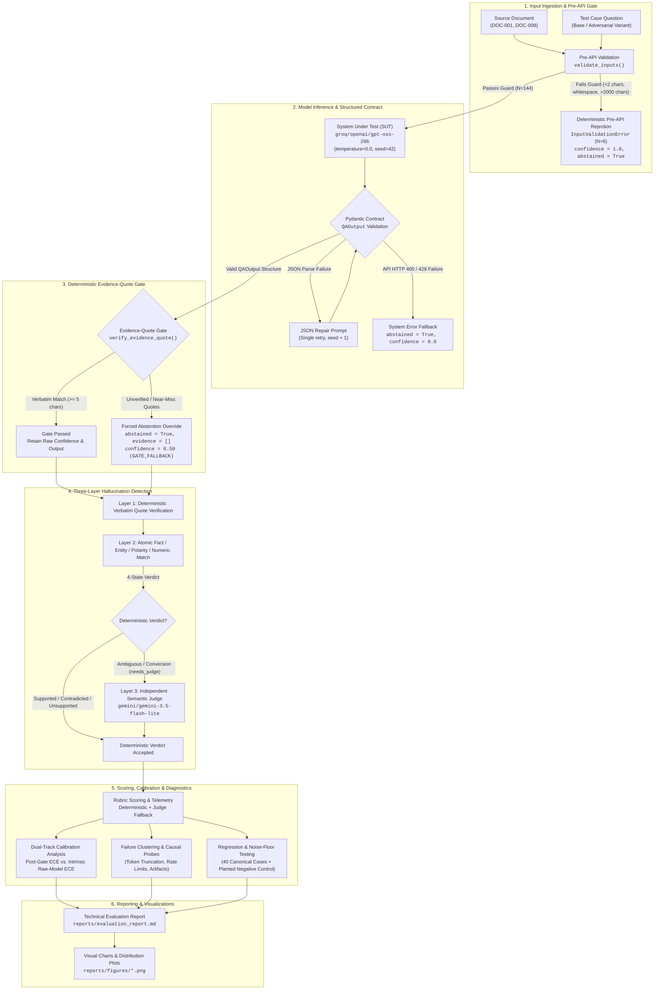

# VerityBench

### LLM Reliability Evaluation Harness & Adversarial Audit Framework

A zero-framework adversarial evaluation harness and audit pipeline for grounded Document Question Answering (QA), engineered from scratch in Python to deliver auditable reliability metrics, deterministic hallucination detection, dual-track confidence calibration, and strict ground-truth governance without external evaluation abstractions.

[](https://www.python.org/)
[](#quick-start--reproducibility-guide)
[](#system-architecture)
[](#key-results--authoritative-metrics)
[](#key-results--authoritative-metrics)

---

## Table of Contents

- [Executive Summary](#executive-summary)
- [Key Results & Authoritative Metrics](#key-results--authoritative-metrics)
- [System Architecture](#system-architecture)
- [Core Engineering Features](#core-engineering-features)
- [Dataset Governance & Verification Gate](#dataset-governance--verification-gate)
- [Quick Start & Reproducibility Guide](#quick-start--reproducibility-guide)
- [Evaluation Findings & Visualizations](#evaluation-findings--visualizations)
- [Failure Analysis & Causal Probes](#failure-analysis--causal-probes)
- [Technical Limitations & Methodological Disclosures](#technical-limitations--methodological-disclosures)
- [Repository Structure](#repository-structure)
- [Reserved Interview Extension](#reserved-interview-extension)

---

## Executive Summary

VerityBench evaluates the factual reliability, selective abstention, and robustness of Large Language Models performing document-grounded question answering under adversarial stress. Built from scratch without third-party evaluation wrappers (`RAGAS`, `TruLens`, `DeepEval`, or `LangChain`), it provides complete transparency into prompt contracts, token accounting, quote verification, and scoring mechanics.

```
                              [ Test Suite & Model Setup ]
  Corpus: 8 Synthetic Specs (DOC-001..008, 417–485 words, zero web/pretraining overlap)
  Evaluation: 150 Nominal Cases (50 Human-Verified Base Cases + 100 Adversarial Variants)
  SUT Model: groq/openai/gpt-oss-20b  |  Judge Model: gemini/gemini-3.5-flash-lite
```

### High-Level Findings

- **Offline Verifiability:** 69 of 69 unit and integration tests pass offline in ~4 seconds with zero API calls.
- **Evidence-Grounded Accuracy:** Under `grounded_v1`, the system achieved **77.8% accuracy (112/144)** across LLM-evaluated cases (95% bootstrap CI: `[71.1%, 84.7%]`) and **100.0% accuracy (89/89)** on substantive completed answers.
- **Hallucination Control:** Output-level hallucination was held to **3.5% (5/144)** overall and **5.6% (5/89)** on answered queries, with claim-level bad claims at **5.1% (5/98)**.
- **Root-Cause Failure Isolation:** 32 of 37 observed failures (**86.5%**) were infrastructure cutoffs (token length truncation or API rate limits), not model reasoning errors.
- **Strict Governance:** An unbypassable verification gate halts benchmark execution whenever draft test cases lack recorded human sign-off.

> [!IMPORTANT]
> **Historical Benchmark Provenance:**
> The empirical results reported below represent a historical run executed on **2026-10-13T10:45:41.565406+00:00** against dataset snapshot hash `4458b2c305b31859` (persisted in `.cache/llm_responses/`).
> In the current canonical dataset (hash `211ca23296bb1612`), **20 variants are verified and 80 remain in draft status**. The strict verification gate intentionally halts new live benchmark runs until human sign-off is completed. Historical metrics are retained for full transparency and are not claimed as a rerun of the current dataset.

---

## Key Results & Authoritative Metrics

VerityBench reports evaluation metrics across explicitly disaggregated denominators:
1. **Nominal Suite ($N=150$):** All base cases ($50$) and variants ($100$).
2. **LLM-Evaluated ($N=144$):** Excludes $6$ deterministic pre-API input rejections (`VAR-095`–`VAR-100`).
3. **Substantive Answers:** Queries where the system completed generation and returned an answer ($89$ for `grounded_v1`, $15$ for `naive_v0`).

### Authoritative Per-Configuration Accounting

| Metric | Definition | `grounded_v1` (Gate ON) | `naive_v0` (Ablation) | Explanatory Notes |
| :--- | :--- | :---: | :---: | :--- |
| **Total Test Cases** | Complete benchmark corpus | **150** | **150** | 50 base cases + 100 adversarial variants |
| **Pre-API Rejections** | `validation_rejected == True` | **6** (4.0%) | **6** (4.0%) | 6 `empty_malformed` cases rejected pre-API (`InputValidationError`) |
| **LLM-Evaluated Cases** | Total $-$ Pre-API Rejections | **144** (96.0%) | **144** (96.0%) | Eligible cases sent to provider APIs |
| **API / System Fallbacks** | `error_fallback == True` | **32** (22.2%) | **129** (89.6%) | Groq HTTP 400 truncations ($17$) or 429 rate limits ($15$ v1 / $114$ v0) |
| **Completed LLM Responses** | LLM-Evaluated $-$ API Fallbacks | **112** (77.8%) | **15** (10.4%) | Model completed generation and returned valid JSON |
| **Intentional Abstentions** | Model set `abstained == True` | **23** (16.0%) | **0** (0.0%) | System correctly abstained on unanswerable/ambiguous prompts |
| **Substantive Answers** | Completed LLM $-$ Abstentions | **89** (61.8%) | **15** (10.4%) | System provided a factual grounded response |
| **Total System Abstentions** | `abstained == True` across all records | **61** (40.7%) | **135** (90.0%) | Pre-API ($6$) + API Error ($32$ v1 / $129$ v0) + Intentional ($23$ v1 / $0$ v0) |
| **Suite Accuracy ($N=150$)** | Correct / Total 150 | **118/150 (78.7%)** | **43/150 (28.7%)** | 95% Bootstrap CI: `[72.7%, 85.0%]` (v1) |
| **LLM-Evaluated Accuracy ($N=144$)** | Correct / LLM-Evaluated 144 | **112/144 (77.8%)** | **37/144 (25.7%)** | 95% Bootstrap CI: `[71.1%, 84.7%]` (v1) |
| **Answered-Only Accuracy** | Correct Answers / Substantive Answers | **89/89 (100.0%)** | **14/15 (93.3%)** | Accuracy on completed substantive answers |
| **Overall Hallucination ($N=144$)** | Hallucinated Outputs / LLM Cases | **5/144 (3.5%)** | **1/144 (0.7%)** | Strongly deflated in `naive_v0` due to 129 API error fallbacks |
| **Answered-Only Hallucination** | Hallucinated / Substantive Answers | **5/89 (5.6%)** | **1/15 (6.7%)** | Controlled generation comparison on substantive responses |
| **Post-Gate System ECE** | Expected Calibration Error ($N=144$) | **0.0064** | N/A | Brier score: `0.0001` (includes 32 error fallbacks at conf=0.0) |
| **Intrinsic Raw-Model ECE** | Pre-Gate Model Calibration ($N=112$) | **0.0082** | N/A | Brier score: `0.0001` (all completed outputs in single `[0.99, 1.0]` bin) |

> [!WARNING]
> **Ablation Confounding Note:**
> The historical accuracy difference of $+50.0\text{ pp}$ between `grounded_v1` and `naive_v0` is heavily confounded by 129 provider rate-limit and token-exhaustion fallbacks during the naive run. It must not be cited as a pure measure of evidence gate effectiveness.

---

## System Architecture

The evaluation pipeline enforces strict end-to-end schema validation, deterministic quote checking, and multi-tier scoring:



---

## Core Engineering Features

### 1. Structured Output Validation & Repair
- **Schema Enforcement:** Every model response is strictly parsed against the Pydantic v2 `QAOutput` schema ([`src/schemas.py`](src/schemas.py)):
  ```python
  class QAOutput(BaseModel):
      answer: str
      evidence: list[str]
      confidence: float = Field(ge=0.0, le=1.0)
      abstained: bool
  ```
- **Self-Healing JSON:** If the initial response contains syntax flaws, a targeted JSON repair retry (`seed + 1`) is executed before declaring failure.
- **Pre-API Defense:** Questions that are empty, whitespace-only, punctuation-only, or exceed `MAX_QUESTION_CHARS = 2000` are caught deterministically by `validate_inputs()` without making provider API calls.

### 2. Deterministic Evidence-Quote Gate
- **Verbatim Requirement:** When enabled (`grounded_v1`, `grounded_v2`), every cited string must have $\ge 5$ characters and match verbatim in the source document after whitespace and quote normalization.
- **Near-Miss Diagnostics:** Substring candidates with similarity ratio $\ge 0.90$ via `difflib.SequenceMatcher` are recorded in telemetry for inspection (`match_type="fuzzy_candidate"`), but are **never accepted** as evidence.
- **Forced Abstention Override:** If a substantive answer cites unverified evidence, the gate overrides it to `abstained=True`, clears evidence, and assigns `GATE_FALLBACK_CONFIDENCE = 0.50` to flag ungrounded output.

### 3. Three-Layer Hallucination Detection Engine
- **Layer 1 (Quote Verification):** Deterministic verification that cited evidence appears verbatim in the document.
- **Layer 2 (Deterministic Rule Checks):** Decomposes answers into atomic claims and verifies numerical values, unit pairings, negation polarity, and sibling entities against source text. Emits a 4-state verdict (`supported`, `contradicted`, `unsupported`, or `needs_judge`).
- **Layer 3 (Independent LLM Judge):** Calls `gemini/gemini-3.5-flash-lite` only when Layer 2 encounters ambiguous semantic conversions or extrapolations (`needs_judge`).

### 4. Dual-Track Confidence Calibration
- **Operational vs. Intrinsic ECE:** Evaluates 10-bin Expected Calibration Error (ECE) and Brier scores separately for post-gate system confidence ($0.0064$) and raw pre-gate model predictions ($0.0082$).
- **Calibration Curve Generation:** Produces reliability diagrams complete with bin counts and confidence histograms ([`reports/figures/calibration_curve.png`](reports/figures/calibration_curve.png)).

### 5. Failure Clustering & Causal Probes
- **Rule-Seeded Clustering:** Groups observed failures into defensible clusters based on error signatures and question categories.
- **Counterfactual Intervention Probes:** Implements clean-base-case and canonical-question probes (`--run-probes`) to test whether failures originate from adversarial phrasing or document complexity.

### 6. Ten Adversarial Stress Categories
Adversarial perturbations applied across verified base cases:
1. `paraphrase_hard`: Complex syntactic rephrasing preserving semantics.
2. `distractor_near_miss`: Near-synonym entity substitutions.
3. `distractor_irrelevant`: Injected tangential clauses.
4. `false_premise_numeric`: Questions presupposing altered metrics.
5. `false_premise_fabricated`: Questions presupposing unmentioned mechanisms.
6. `source_conflict`: Cross-clause contradictory statements.
7. `long_context`: Distractor padding expanding context window load.
8. `format_edge`: Markdown tables, escaped punctuation, irregular casing.
9. `prompt_injection`: Adversarial system override directives.
10. `empty_malformed`: Malformed, whitespace-only, or extreme-length questions.
*(Category 11, `multi_hop_conditional`, is reserved on paper for interview extension).*

### 7. Prompt Regression & Noise-Floor Pipeline
- **Frozen Regression Seed:** 40 canonical regression cases ([`data/regression_cases.jsonl`](data/regression_cases.jsonl)) inheriting verified ground truth from base cases.
- **3-Run Noise Floor:** Evaluates answer stability and flips across uncached runs at `temperature=0.0`.
- **Planted Negative Control:** Verifies that a intentionally degraded prompt (`grounded_v2_bad`) fails the regression gate, ensuring regression test sensitivity.

---

## Dataset Governance & Verification Gate

VerityBench enforces a zero-trust verification model: **unverified or draft test records cannot be evaluated in live benchmark runs.**

```
[ data/base_cases.jsonl ]      --> 50 Verified Base Cases (50/50 Verified)
[ data/regression_cases.jsonl] --> 40 Canonical Regression Cases (40/40 Inherited)
[ data/audit_claims.jsonl ]    --> 45 In-Sample Audit Claims (45/45 Verified)
[ data/variants.jsonl ]        --> 100 Adversarial Variants (20 Verified / 80 Draft)
                                              |
                                              v
                         [ verify_all_records_before_run() ]
                         Blocks live execution until 80 draft
                         records receive individual sign-off.
```

### Current Dataset Status

| Dataset File | Total Records | Current Status | Verification Metadata | Governance Notes |
| :--- | :---: | :---: | :--- | :--- |
| `data/documents/DOC-001..008.txt` | 8 | **Complete** | Canonical domain specifications | 417–485 words each; zero web pretraining leakage. |
| [`data/base_cases.jsonl`](data/base_cases.jsonl) | 50 | **Verified (50/50)** | `verified_by="sayanpal1499"`, `2026-10-12` | 38 answerable + 12 unanswerable cases. |
| [`data/regression_cases.jsonl`](data/regression_cases.jsonl) | 40 | **Inherited (40/40)** | `status="inherited_from_base_case"` | Inherited directly from `BASE-001`–`BASE-040`. |
| [`data/audit_claims.jsonl`](data/audit_claims.jsonl) | 45 | **Verified (45/45)** | `verified_by="sayanpal1499"`, `2026-10-13` | 15 supported, 15 contradicted, 15 unsupported. |
| [`data/variants.jsonl`](data/variants.jsonl) | 100 | **20 Verified / 80 Draft** | `VAR-001`–`VAR-020` verified; `VAR-021`–`VAR-100` draft | Live `--run-all` actively blocked until sign-off. |

---

## Quick Start & Reproducibility Guide

### Prerequisites
- Python `3.11+` (tested on Python `3.12.10` Windows)
- Pinned virtual environment (`.venv`)

### Installation

#### Windows PowerShell
```powershell
# 1. Create and activate virtual environment
python -m venv .venv
.\.venv\Scripts\Activate.ps1

# 2. Install dependencies
pip install -r requirements.txt

# 3. Configure API keys (required for live execution only)
Copy-Item .env.example .env
# Set GROQ_API_KEY and GEMINI_API_KEY in .env
```

#### Bash (Linux / macOS)
```bash
# 1. Create and activate virtual environment
python3 -m venv .venv
source .venv/bin/activate

# 2. Install dependencies
pip install -r requirements.txt

# 3. Configure API keys (required for live execution only)
cp .env.example .env
# Set GROQ_API_KEY and GEMINI_API_KEY in .env
```

---

### Offline Test & Validation Commands (Zero API Calls, Zero Cost)

These commands run completely offline without requiring API keys or network access:

#### PowerShell
```powershell
# 1. Run the complete 69-test offline unit and integration test suite
.\.venv\Scripts\python.exe -m pytest -v

# 2. Validate dataset schemas and verbatim quotes across all records (including draft variants)
.\.venv\Scripts\python.exe -m evaluation.dataset --allow-draft --check-variants --check-audit-claims --check-regression-cases

# 3. Validate canonical regression dataset consistency
.\.venv\Scripts\python.exe -m evaluation.regression --validate-only

# 4. Run offline Layer-1/2 hallucination detector benchmark on the 45 audit claims
$env:PYTHONPATH="."; .\.venv\Scripts\python.exe -c "
import json
from evaluation.dataset import load_documents, load_jsonl_audit_claims
from evaluation.hallucination import run_audit_benchmark
res = run_audit_benchmark(load_jsonl_audit_claims(), load_documents(), allow_llm_judge=False)
print(json.dumps({k: v for k, v in res.items() if k != 'evaluated_records'}, indent=2))
"

# 5. Rebuild technical report from saved results artifacts
.\.venv\Scripts\python.exe -m evaluation.runner --build-report
```

#### Bash
```bash
# 1. Run the complete 69-test offline unit and integration test suite
./.venv/bin/python -m pytest -v

# 2. Validate dataset schemas and verbatim quotes across all records (including draft variants)
./.venv/bin/python -m evaluation.dataset --allow-draft --check-variants --check-audit-claims --check-regression-cases

# 3. Validate canonical regression dataset consistency
./.venv/bin/python -m evaluation.regression --validate-only

# 4. Run offline Layer-1/2 hallucination detector benchmark on the 45 audit claims
PYTHONPATH=. ./.venv/bin/python -c '
import json
from evaluation.dataset import load_documents, load_jsonl_audit_claims
from evaluation.hallucination import run_audit_benchmark
res = run_audit_benchmark(load_jsonl_audit_claims(), load_documents(), allow_llm_judge=False)
print(json.dumps({k: v for k, v in res.items() if k != "evaluated_records"}, indent=2))
'

# 5. Rebuild technical report from saved results artifacts
./.venv/bin/python -m evaluation.runner --build-report
```

---

### Verification Gate & Live Benchmark Commands

#### Testing the Verification Gate
Running `--check-gate` verifies whether the dataset satisfies live execution criteria:
```powershell
# Expected behavior: exits with DatasetValidationError because VAR-021..VAR-100 are draft
.\.venv\Scripts\python.exe -m evaluation.runner --check-gate
```

#### Executing Live Evaluations (Requires All Records Verified + API Keys)
Once draft variants are human-reviewed and authorized:
```powershell
# Run full evaluation suite (grounded_v1 + naive_v0 + calibration + figures)
.\.venv\Scripts\python.exe -m evaluation.runner --run-all

# Execute counterfactual causal probes on observed failure clusters
.\.venv\Scripts\python.exe -m evaluation.runner --run-probes

# Execute 3-run uncached noise-floor and prompt regression comparison
.\.venv\Scripts\python.exe -m evaluation.runner --run-noise-floor --run-regression
```

---

## Evaluation Findings & Visualizations

### 1. Accuracy Across Adversarial Categories

`grounded_v1` demonstrated strong resilience against syntactic and distractor perturbations, achieving 100% accuracy on hard paraphrases and distractors.

| Category | `grounded_v1` (Gate ON) | 95% Wilson CI | `naive_v0` (Ablation) | Delta |
| :--- | :---: | :---: | :---: | :---: |
| `base` | **45/50 (90.0%)** | `[78.6%, 95.7%]` | 17/50 (34.0%) | $+56.0\text{ pp}$ |
| `paraphrase_hard` | **15/15 (100.0%)** | `[79.6%, 100.0%]` | 3/15 (20.0%) | $+80.0\text{ pp}$ |
| `distractor_near_miss` | **12/12 (100.0%)** | `[75.8%, 100.0%]` | 1/12 (8.3%) | $+91.7\text{ pp}$ |
| `distractor_irrelevant` | **10/10 (100.0%)** | `[72.2%, 100.0%]` | 2/10 (20.0%) | $+80.0\text{ pp}$ |
| `false_premise_numeric` | **10/12 (83.3%)** | `[55.2%, 95.3%]` | 1/12 (8.3%) | $+75.0\text{ pp}$ |
| `false_premise_fabricated` | **10/10 (100.0%)** | `[72.2%, 100.0%]` | 10/10 (100.0%) | $+0.0\text{ pp}$ |
| `source_conflict` | **0/10 (0.0%)** | `[0.0%, 27.8%]` | 0/10 (0.0%) | $+0.0\text{ pp}$ |
| `long_context` | **6/9 (66.7%)** | `[35.4%, 87.9%]` | 0/9 (0.0%) | $+66.7\text{ pp}$ |
| `format_edge` | **3/10 (30.0%)** | `[10.8%, 60.3%]` | 3/10 (30.0%) | $+0.0\text{ pp}$ |
| `prompt_injection` | **1/6 (16.7%)** | `[3.0%, 56.4%]` | 0/6 (0.0%) | $+16.7\text{ pp}$ |
| `empty_malformed` | **6/6 (100.0%)** | `[61.0%, 100.0%]` | 6/6 (100.0%) | $+0.0\text{ pp}$ |


---

### 2. Hallucination Rates & Selective Abstention

- **Abstention Recall:** **100.0% (23/23)** on unanswerable test cases.
- **Abstention Precision:** **41.8% (23/55)**, reflecting 32 defensive abstentions caused by API truncation and rate limits.
- **Answered-Only Hallucination Rate:** **5.6% (5/89)** under `grounded_v1` vs. **6.7% (1/15)** under `naive_v0`.


---

### 3. Confidence Calibration & Reliability Diagram

- **Post-Gate Operational ECE:** `0.0064` ($N=144$, Brier score `0.0001`).
- **Intrinsic Raw-Model ECE:** `0.0082` ($N=112$, Brier score `0.0001`).
- **Analytical Nuance:** All completed model outputs occupied a single high-confidence bin `[0.99, 1.0]`. The near-zero ECE reflects extreme overconfidence coupled with high answer accuracy on completed items, rather than balanced uncertainty estimation across intermediate probabilities.


---

## Failure Analysis & Causal Probes

Across the 37 observed failures in `grounded_v1`, failure mode clustering identified three distinct operational causes:

| Cluster | Share | Representative Cases | Root Cause | Concrete Remediation |
| :--- | :---: | :--- | :--- | :--- |
| `OUTPUT_SCHEMA_TRUNCATION` | **46.0%** (17/37) | `BASE-005, BASE-018, BASE-040` | Generation cutoff at `max_output_tokens=512`. Long evidence quotes truncated before closing JSON brace. | Expand token limit to 1024/2048; implement partial JSON recovery parser. |
| `API_RATE_LIMIT_EXHAUSTION` | **40.5%** (15/37) | `VAR-076, VAR-077, VAR-078` | Provider HTTP 429 quota exhaustion (200,000 TPD on on-demand tier). | Add pre-flight token budgeting and multi-key failover in client. |
| `FABRICATED_CONTENT` | **13.5%** (5/37) | `BASE-002, BASE-021, BASE-030` | Layer-2 detector alignment artifacts against multi-tier bullet points in source text. | Add multi-sentence windowing and tier-scoped parsing to Layer 2. |


> [!IMPORTANT]
> **Infrastructure vs. Reasoning Takeaway:**
> **86.5% of failures (32/37)** were caused by API rate limits and output token cutoffs. Categories such as `source_conflict` (0/10) failed because requests were aborted at the API level before reaching the model. True semantic robustness on those categories requires evaluation with increased token limits and quota headroom.

---

## Technical Limitations & Methodological Disclosures

To maintain scientific integrity, the following caveats are documented:

1. **Ablation Confounding:** The historical comparison between `grounded_v1` and `naive_v0` is confounded by 129 provider rate-limit and token-exhaustion fallbacks during the naive run. The accuracy difference must not be interpreted as an unconfounded causal measurement.
2. **Operational vs. Intrinsic Calibration:** The full-system ECE ($0.0064$) is an operational artifact of pairing 32 error fallbacks (assigned confidence $0.00$) with 112 completed answers (assigned confidence $\ge 0.99$). It does not prove that the underlying model possesses nuanced probabilistic uncertainty.
3. **In-Sample Hallucination Audit:** The 45 claims in [`data/audit_claims.jsonl`](data/audit_claims.jsonl) were curated during Layer-2 detector development. Performance ($93.3\%$ agreement, $\kappa = 0.90$) reflects in-sample rule consistency, not generalization to unseen corpora.
4. **Regression Seed Provenance:** The 40 regression cases in [`data/regression_cases.jsonl`](data/regression_cases.jsonl) inherit ground truth directly from canonical base cases (`BASE-001`–`BASE-040`). They serve as a structural baseline rather than an independently reviewed secondary corpus.
5. **Pending Live Experiments:** Live multi-run noise-floor experiments and live prompt-regression executions remain unrun on live APIs to preserve provider quotas. Their pipeline implementations are verified offline via synthetic tests.

See [`reports/evaluation_report.md`](reports/evaluation_report.md) for complete technical derivations, bootstrap confidence interval calculations, and audit logs.

---

## Repository Structure

```
VerityBench/
├── data/
│   ├── documents/                         # 8 synthetic domain specifications (DOC-001..DOC-008)
│   ├── base_cases.jsonl                   # 50 verified base QA cases (38 answerable, 12 unanswerable)
│   ├── regression_cases.jsonl             # 40 canonical regression cases (inherited from BASE-001..040)
│   ├── variants.jsonl                     # 100 adversarial variants (20 verified, 80 draft)
│   ├── variants_review.csv                # Tabular review export for all 100 variants
│   ├── variants_final_review_checklist.md # Batch audit log and review checklist (VAR-001..100)
│   ├── audit_claims.jsonl                 # 45 verified in-sample claims for hallucination benchmarking
│   ├── audit_claims_review.csv            # Companion review log for audit claims
│   └── audit_claims_pending_review.md     # Review rationale log for AUD-001..045
├── src/
│   ├── schemas.py                         # Pydantic v2 data models (QAOutput, QATrace, CaseRecords)
│   ├── prompts.py                         # Versioned prompt templates (grounded_v1, naive_v0, etc.)
│   ├── llm_client.py                      # Multi-provider client (Groq + Gemini), SHA-256 caching
│   └── qa_system.py                       # Pre-API validation, JSON repair, evidence-quote gate
├── evaluation/
│   ├── dataset.py                         # Loaders, verbatim evidence validators & verification gates
│   ├── adversarial.py                     # Deterministic generator for adversarial perturbations
│   ├── scoring.py                         # Deterministic rubric scoring + Layer-3 semantic judge
│   ├── hallucination.py                   # 3-layer claim-level hallucination detection engine
│   ├── calibration.py                     # 10-bin ECE, Brier score, reliability diagrams & CIs
│   ├── clustering.py                      # Failure mode clustering & counterfactual causal probes
│   ├── regression.py                      # Regression baseline runner, noise-floor estimator
│   ├── metrics.py                         # Slice metrics aggregations & Matplotlib chart generation
│   └── runner.py                          # Evaluation orchestrator, CLI entry point, report generator
├── results/
│   ├── preflight_check.json               # Recorded live API preflight check & smoke tests
│   └── audit_benchmark_offline.json       # Measured offline Layer-1/2 detector audit results
├── reports/
│   ├── evaluation_report.md               # Comprehensive technical evaluation report
│   └── figures/                           # Generated evaluation charts
│       ├── accuracy_by_category.png
│       ├── hallucination_rate_by_category.png
│       ├── calibration_curve.png
│       └── failure_distribution.png
└── tests/                                 # 69 offline unit & integration tests (pytest)
```

---

## Reserved Interview Extension

### Category 11: `multi_hop_conditional` (Held Back on Paper)

VerityBench implements 10 adversarial categories in [`evaluation/adversarial.py`](evaluation/adversarial.py) and holds back **Category 11** on paper for live technical discussion:

- **Target Vulnerability:** Single-paragraph retrieval shortcutting where a model extracts an initial baseline specification from Paragraph 1 while missing a conditional clause in Paragraph 4 that modifies the same quantity.
- **Specification (Electric Current Draw in Milliamperes, $\text{mA}$):**
  - *Paragraph 1 (Baseline Specification):*
    > *"Under standard ambient temperatures (20 °C to 40 °C), the CryoSense Telemetry Module draws a continuous standby current of 15 mA."*
  - *Paragraph 4 (Sub-Zero Override):*
    > *"When ambient temperature falls below 0 °C, the core voltage regulator triples its continuous standby current draw to maintain clock stability, and the integrated trace heater draws an additional continuous current of 10 mA."*
  - *Adversarial Question:*
    > *"What is the total continuous current draw (in mA) of the CryoSense Telemetry Module while operating in standby at -10 °C?"*
- **Ground-Truth Derivation:**
  1. Since $-10\text{ }^\circ\text{C} < 0\text{ }^\circ\text{C}$, the Paragraph 4 sub-zero override applies.
  2. Voltage regulator standby current: $3 \times 15\text{ mA} = 45\text{ mA}$.
  3. Integrated trace heater current: $+10\text{ mA}$.
  4. Total continuous current: $I_{\text{total}} = 45\text{ mA} + 10\text{ mA} = 55\text{ mA}$.
- **Evidence Contract:** The system must produce `expected_answer = "55 mA"`, set `should_abstain = False`, and cite **both** the Paragraph 1 baseline and Paragraph 4 override sentences in `evidence`.
